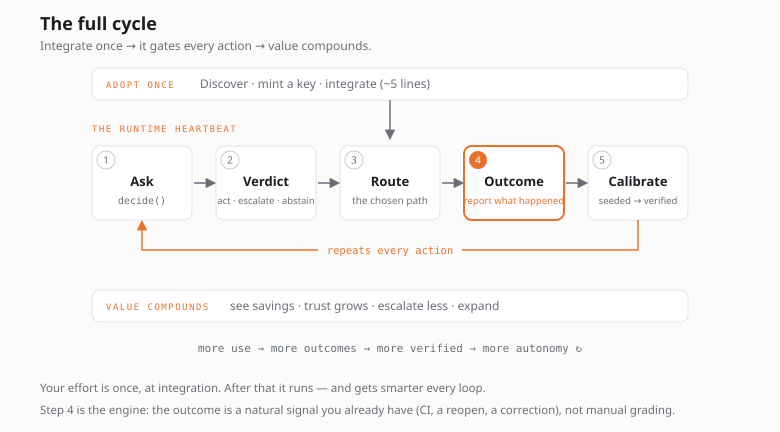

# Warm Winter examples

**Letting an agent merge its own PRs or fire its own tools is great — until the one
time it shouldn't have.** These are copyable examples of putting a calibrated check
in front of those decisions with [Warm Winter](https://warmwinter.io): before the
action, it says **act, escalate, or abstain** — and abstains when it isn't grounded
enough to be sure. You keep executing; it only judges and records the outcome you report. A caller-reported outcome is not automatically independent evidence or earned competence.



```bash
pip install warmwinter      # Python
npm install warmwinter      # TypeScript / JavaScript
```

Mint a key on the [dashboard](https://warmwinter.io), then:

| Example | What it gates |
|---|---|
| [`model-routing/`](model-routing/) | Is the cheap model enough here, or escalate to a stronger model? The published historical quality/cost figures are reference backtests, not a guarantee for your workload. |
| [`auto-merge/`](auto-merge/) | Should an agent's PR auto-merge unsupervised? Use separately verified, protected CI evidence before treating any outcome as strong. |
| [`tool-call/`](tool-call/) | Should an agent execute this tool call, or stop and ask a human? Stakes scale with reversibility. |
| [`claude-code/`](claude-code/) | Gate your **Claude Code** agent's tool calls via a hook. Starts in shadow (observe-only, zero friction) and earns autonomy as CI/health outcomes verify each cell. |
| [`codex/`](codex/) | Observe **Codex** local tool calls through supported lifecycle hooks. Shadow-only: Codex permissions remain authoritative while cells learn. |
| [`rag/`](rag/) | Is the retrieval grounded enough to answer, or abstain instead of guessing? |
| [`support/`](support/) | Auto-resolve the ticket, or route to a human? The reopen is the verifier. |

The gate **advises** — your code decides whether to act. It never sits in your
execution path. The objective is well-evidenced calibration, not automatic self-certification. Seed/backtest evidence is a **reference portfolio**; it must not be presented as verified competence earned by a new account. See the [developer contract](https://www.warmwinter.io/developers) for the current API surface and credential scopes.

**Agent integration status:** Run-lifecycle and seven consultation helpers are in separately reviewed development PRs, not guaranteed in the currently published packages. A runtime-bound Gate key and a consultation-only key are different credentials; neither confers autonomous execution authority. Ordinary bearer-authenticated `/gate/outcome/by-ref` reports are caller-asserted and must not be treated as independently verified CI/deploy proof. The protected observer/OIDC integration is the separate strong-evidence path.
